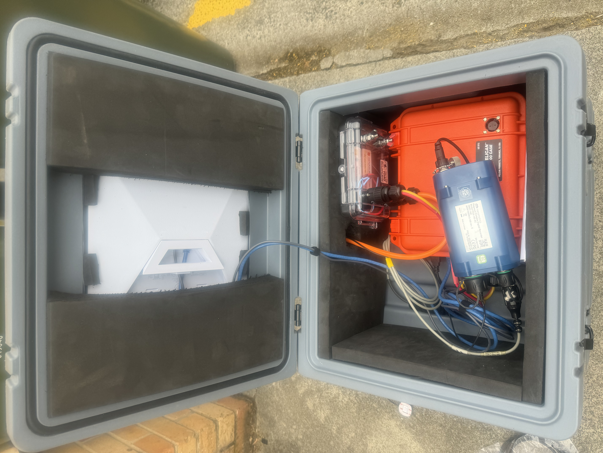

# TELE: remote seismic data collection

TELE collects data from seismic stations where power and internet
access are limited. It runs on an Ubuntu edge computer connected to a Nanometrics
Pegasus recorder and uses Starlink to upload data to Dropbox.

The idea is simple: wake the computer, collect and upload the data, send a status
email, then switch off again. Limit the up-time to save battery power and ensure that the teh computer powers down after completed tasks. The loggers continues recording while the computer is off, so there is no need to leave the computer and Starlink running.

The system has been running in Australia, and the Antarctic station has been
transmitting data since February 2026. I am still testing this software update,
so please contact me before using it at an unattended field site.


## Hardware and setup

The setup uses a Shuttle SPCEL03, a Starlink Mini, and a USB-controlled relay.
The BIOS wakes the computer once a week. USB 5 V operates the relay, so Starlink
powers up with the computer and switches off when the computer shuts down.



Test setup. Photo: Tobias Stål.

The full [installation and field deployment guide](INSTALLATION.md) includes
the hardware choices, supplier links, photographs, Ubuntu setup, credentials,
remote access and testing instructions. Start there if you are building a station.

## Where to start

I recommend working through a new station in this order. Keep automatic field
operation disabled until the individual tests pass.

| Stage | What to do | Detailed instructions |
|---|---|---|
| Hardware | Assemble the computer, recorder, relay and Starlink; check poweroff and BIOS wake-up | [Hardware and enclosure](INSTALLATION.md#hardware-and-enclosure) |
| Ubuntu and software | Install dependencies, find the native Harvester and identify the correct recorder disk | [Ubuntu setup](INSTALLATION.md#install-and-prepare-ubuntu) |
| Accounts | Choose the project Dropbox identity and create a Gmail app password for email | [Dropbox accounts](INSTALLATION.md#choose-the-upload-account), [Gmail app password](INSTALLATION.md#gmail-app-password-setup) |
| Configuration | Set local hardware details and matching local/remote `station` labels | [Configuration file map](INSTALLATION.md#configuration-file-map) |
| Bench tests | Check a real export, a small verified upload, email and remote access separately | [First-harvest checks](INSTALLATION.md#check-the-first-export-before-uploading), [Bench testing](INSTALLATION.md#bench-testing-and-field-activation) |
| Field operation | Review the power deadlines, enable the services and observe a full wake/shutdown cycle | [Field activation](INSTALLATION.md#explicit-field-mode-activation) |

Command blocks in the guide identify the computer or session where they run.
The Mac is useful for Git, browser authorization and SSH; Ubuntu runs the
recorder commands and the field services.

There are three different tools involved: **Git** updates source code from
GitHub, **rclone** transfers data to Dropbox, and **rsync** is not used by TELE
for Dropbox authentication or uploads. Pulling the repository does not install
the software or update an already installed station.

## How it works

TELE uses Bash to call the native Pegasus Harvester and rclone for Dropbox
transfers. It exports waveform miniSEED, SOH, legacy SOH and logs without creating
a large PSF image.

Each run:

1. Loads the station settings and checks its configuration.
2. Checks Dropbox and reads Starlink diagnostics.
3. Runs each configured recorder independently, retrying its pending uploads
   before identifying its whole-disk by-id path and serial.
4. Exports the required UTC days into separate local working directories.
5. Uploads files and verifies their Dropbox-compatible content hashes.
6. Records progress only after verification.
7. Uploads logs, attempts a status email and opens a maintenance window if requested.
8. In field mode, exits into systemd-controlled poweroff. Bench mode does not shut down.

An unfinished export is not uploaded as if it were complete. Completed exports
that have not been verified in Dropbox stay on the computer for another attempt,
and that retry does not depend on the recorder still being connected.

By default, the last verified daily batch is also kept locally. Older verified
payloads are removed, while the small progress records and recent logs remain.

## Dropbox layout

Each station has its own directory and configuration:

```text
<dropbox_root>/tele/<station_name>/
  config.txt
  pegasus_harvester/
    <native Harvester directories and filenames>
  tele_logfiles/
    <run logs and diagnostics>
    harvest/
    receipts/<recorder_serial>/
  <future_extension>/
```

The Harvester's file paths are left unchanged. The script requests daily waveform
files with `-d=24` and does not replace the native path pattern with `-p`.

There is no recorder-erasure command or Dropbox deletion in the collection
workflow. Native SOH/log naming and files crossing day boundaries still need
checking with the actual recorder before deployment.

For shared/team Dropbox storage, authorize the account that has accepted the
invitation and has permission to add files. I recommend a project-owned uploader
account rather than leaving a field computer tied to a personal account.

`DROPBOX_ROOT` accepts spaces and preserves a leading `/`, including team-root
paths such as `/Research Team/Project`. Check the exact destination with rclone
and a small test upload before collecting a full backlog; a valid path is not
proof that the authorized account has access to the intended team folder.

## Install and test

Use [INSTALL.sh](INSTALL.sh) on the Ubuntu station. Start with the
[commented credentials and setup example](credentials.example.txt) and follow the
[master installer instructions](INSTALLATION.md#master-installer); do not put
real credentials in the repository.

`credentials.example.txt` is tracked deliberately; it contains only placeholders
and explanations of the Gmail app password, Dropbox OAuth, Tailscale auth key and
VNC password. Copy it to a protected private file before editing, never replace
the placeholders in the tracked example. `config/credentials.txt.example` is the
separate email-only template for the installed runtime.

```bash
# Run on: Ubuntu station, from the reviewed checkout.
bash INSTALL.sh --mode plan
sudo bash INSTALL.sh --config /root/tele-setup.conf --mode confirm
# For repeated, prepared deployments instead:
sudo bash INSTALL.sh --config /root/tele-setup.conf --mode auto
```

The installer fetches one Git revision, installs dependencies and the supplied
Nanometrics package, configures Linux, Dropbox, email, Tailscale, VNC and systemd,
and runs setup checks. It does not reboot or activate shutdown-capable operation
unless `--enable-field` is explicitly supplied, which enables it for the next boot.
BIOS wake settings, USB power behaviour and vendor/account authorization still
need preparation. A normal email/password pair cannot replace Dropbox OAuth.

After installation:

```bash
# Run on: Ubuntu bench station. Check identity without collecting, emailing or shutting down.
sudo /opt/tele/current/tele.sh --check
# A real collection/upload/email run, without a maintenance wait or shutdown.
sudo /opt/tele/current/tele.sh --once
```

Both commands refuse to run while the field collector or emergency timer is active.
Use stable bench power: bench mode deliberately does not provide automatic poweroff.

## Adding recorders and modules

`tele.sh` shows the run sequence from top to bottom. Shared workflow functions
are in `lib/`; collector implementations belong in `modules/`, with one private
data-only profile per source in `/etc/tele/sources.d/`.

With no source profiles, the single-recorder settings in `node.conf` keep the
existing `pegasus_harvester/` layout. Explicit profiles use
`pegasus_harvester/<source-id>/` so recorders do not overwrite one another; the
Harvester paths inside remain unchanged. Moving an existing recorder to a profile
is a deliberate namespace migration, not an automatic relocation of pending files.
See the [module contract and examples](docs/MODULES.md) before changing that layout.

## Starlink snow melt

The [Starlink instructions](docs/STARLINK.md) cover Ethernet readback and an
explicitly confirmed attempt to set Off. The local interface exposes the setting,
but firmware may refuse writes; the supported app setting is
Settings → Starlink → Snow Melt → Off ([Starlink help](https://starlink.com/en-ps/support/article/123263fe-abc5-60e0-3af1-9e022aeba80a),
[local API restrictions](https://github.com/sparky8512/starlink-grpc-tools/issues/48)).

TELE does not silently reconfigure the antenna on each wake. Verify the setting
after a power cycle and firmware changes, and consider snow-obstruction risk
before disabling heating at a snowy site.

## Collection modes

Most runs should use `incremental`. The other modes are there for checking or
repairing the archive without changing the normal folder structure.

| Mode | What it does |
|---|---|
| `incremental` | Collects unverified days and revisits recent/open days, skipping identical uploaded contents. |
| `reconcile` | Re-exports the recorder's retained history and uploads only missing or changed files. |
| `reupload` | Re-exports the retained history and deliberately sends every file again for a new request. |
| `range` | Repairs a specified range of whole UTC days, uploading missing or changed contents. |

`reconcile`, `reupload` and `range` need a `REQUEST_ID`. Keep the same ID while
a large request is being completed across several wakes, and use a new ID when
you want to start another request.

## Station configuration

Set the upload label with `station` in `config.txt`. For example,
`station=station01` sends data to
`<dropbox_root>/tele/station01/pegasus_harvester/` and logs to
`<dropbox_root>/tele/station01/tele_logfiles/`.

Keep a private local copy at `/etc/tele/config.txt` so the computer knows which
Dropbox folder to read at startup. Upload the matching remote copy to
`<dropbox_root>/tele/station01/config.txt`; its `station` must match the local
label. This prevents a config copied to the wrong station from redirecting data.

Labels use 1–64 letters, numbers, dots, underscores or hyphens, starting with a
letter or number. Settings are literal values, not shell commands. The label
only controls the outer upload/state directories; it does not rename the
Harvester's native files or change seismic station metadata.

For normal weekly collection:

```ini
station=station01
EXECUTE=auto
HARVEST_MODE=incremental
HARVEST_BUDGET_SECONDS=3600
LOCAL_DATA=keep
```

To leave time for SSH access after collection:

```ini
station=station01
EXECUTE=ssh
HARVEST_MODE=incremental
MAINTENANCE_IDLE_SECONDS=600
LOCAL_DATA=keep
```

To check the full recorder archive without unnecessarily sending matching
files again:

```ini
station=station01
EXECUTE=auto
HARVEST_MODE=reconcile
REQUEST_ID=full-check-2026-09
```

Use `EXECUTE=vnc` for the private virtual desktop, or `HARVEST_MODE=reupload`
with a new request ID to force a full retransmission. The installation guide
lists all settings, valid values and date-range examples.

Passwords, Dropbox tokens, device paths and executable paths do not belong in
the Dropbox configuration. Private credentials and local station identity are
kept separately on the computer.

For email, `EMAIL_PASSWORD` means a **Gmail app password**, not the normal Google
password or a two-step verification code. Follow the
[app-password walkthrough](INSTALLATION.md#gmail-app-password-setup) and the
[credential/password-change notes](INSTALLATION.md#which-password-or-token-goes-where)
before entering account details on the station.

## Power and remote access

Battery protection is important here. A failed upload or stuck process must not
leave the computer and Starlink running indefinitely.

- **Collection:** the default one-hour allowance is shared between sources,
  including pending transfers and device inspection. External calls are bounded;
  termination grace and local bookkeeping can extend wall-clock time slightly.
- **Normal shutdown:** the systemd service requests poweroff when the collector
  exits, including after a failure.
- **Emergency shutdown:** a separate timer requests poweroff four hours after
  boot, including during a remote session.
- **Maintenance:** `ssh` and `vnc` modes wait for 10 idle minutes by default after
  the work is finished. Detected connections reset that countdown.
- **Auto mode:** finishes the work and reporting without a maintenance wait.

I use Tailscale for remote access and a private VNC desktop when a graphical
session is useful. VNC is reached through an SSH tunnel rather than a public port.

There is no independent hardware power-cut timer in this setup. The software
timer protects against a stalled collection script, but it cannot guarantee
shutdown if Ubuntu or the firmware itself freezes.

## Testing and deployment

The automated suite covers configuration, station isolation, acquisition failures,
hash verification, retries, retention and maintenance timing. It uses a synthetic
Harvester and real local rclone file operations, not a real recorder or live Dropbox.

On an Ubuntu development or bench machine with the dependencies installed:

```bash
# Run on: Ubuntu bench/development machine, inside the source checkout.
bash tests/run.sh
bash tests/installer.sh
shellcheck -S warning -e SC2034 INSTALL.sh tele.sh lib/common.sh lib/config.sh \
  lib/hardware.sh lib/harvest.sh lib/upload.sh lib/notification.sh \
  lib/remote.sh lib/workflow.sh lib/sources.sh lib/starlink.sh modules/*.sh scripts/*.sh tests/*.sh
```

SC2034 is excluded because the sourced Bash modules share configuration variables.
These tests do not access the recorder, send email or shut down the computer.

Before field use, check real miniSEED completeness, Dropbox interruption recovery,
SSH/VNC sessions, BIOS wake-up and the physical USB-relay shutdown. Starting the
field service is different from running the tests: it can power the computer off.

The entry point is `tele.sh`, with `tele.service` and the `tele-power-guard.timer`.
Existing installations need their paths, units and local config updated together;
read the [rename and station-label notes](docs/RENAME.md) before enabling them.

Use a tested release or exact Git commit for each station. Do not automatically
pull `main` on every wake, and keep credentials, pending data and progress records
outside the application checkout.

If updating an existing checkout, check for local edits before pulling.
The [update and recovery instructions](INSTALLATION.md#pulling-updates-to-your-source-checkout)
explain the difference between updating Git, installing a release and changing
the upload destination.

## Documentation and next steps

- **[Installation guide](INSTALLATION.md):** hardware, photos, suppliers and the
  complete setup procedure.
- **[Design notes](docs/DESIGN.md):** collection, verification and recovery behaviour.
- **[Test checklist](docs/VALIDATION.md):** checks to complete before deployment.

The installer and module framework still need end-to-end bench testing on the
target Ubuntu computer. Automated tests use mocks and local files, not a real
Nanometrics recorder, live Dropbox or antenna. Camera support is not implemented;
the disabled module template is for future development.

If you build a station or find something that can be improved, please get in
touch or open an issue in this repository. I would like to keep the setup
practical, easy to understand and reliable enough to leave in the field.

Software: `4.0.1`. Documentation updated: 13 October 2026. Record the Git revision as well.
